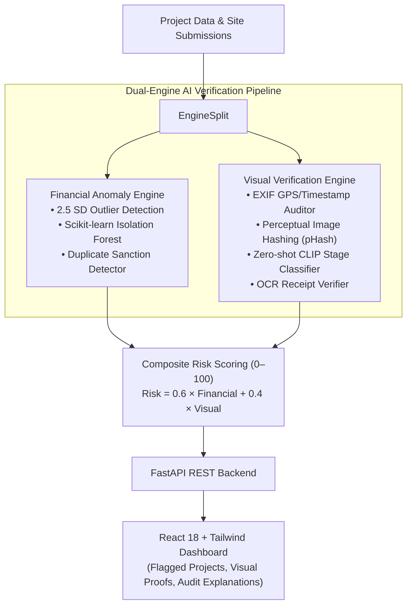

# 🛡️ AI Sentinel — MPLADS Fraud & Anomaly Detection Platform

[](https://www.python.org/)
[](https://fastapi.tiangolo.com/)
[](https://scikit-learn.org/)
[](https://github.com/openai/CLIP)
[](https://react.dev/)
[](https://www.sih.gov.in/)

**Smart India Hackathon 2026 · Problem Statement SIH26102**  
*"Development of an AI-powered system to detect anomalies, fraud, and inefficiencies in MPLAD Scheme implementation"*

AI Sentinel verifies both the **financial data** and the **physical/visual evidence** of public works projects, flagging suspicious activities with human-interpretable explanations for government auditors and district collectors.



---

## Architecture

```
backend/
  seed_data.py            # generates simulated projects.csv + submissions.csv (~13% anomalies)
  generate_mock_images.py # synthesizes demo site photos + receipts (no real MPLADS photos exist)
  build_db.py             # runs both engines over the CSVs, writes data/sentinel.db
  app/
    financial_engine.py   # rule-based (2.5 SD) + Isolation Forest anomaly detection
    image_verification.py # EXIF, perceptual hash dedup, CLIP stage classifier, OCR receipt check
    database.py            # SQLite schema + connection helper
    main.py                 # FastAPI app (all endpoints)
frontend/
  React + Vite + Tailwind dashboard (Overview, All Projects, Flagged, Project Detail)
```

**Data flow:** `seed_data.py` → `generate_mock_images.py` → `build_db.py` (runs both AI engines,
populates SQLite) → FastAPI serves the results → React dashboard visualizes them.

---

## How the risk scoring works (for judging Q&A)

Every project gets an **overall_risk_score (0–100)** = `0.6 × financial_risk_score + 0.4 × visual_risk_score`.

**Financial risk score** combines:
- **Rule-based flags** — cost or duration beyond **2.5 standard deviations** from the category
  average (computed both nationally and per-district), stalled status, and near-duplicate project
  detection (same category + district + agency, sanctioned cost within 3%).
- **ML layer** — an **Isolation Forest** trained on `[cost, duration, category, district, cost_per_day]`
  catches subtler multi-feature anomalies that a single rule wouldn't catch alone.

**Visual risk score** (per submission; a project takes its *worst* submission score) combines:
- **EXIF check** — missing GPS/timestamp, or GPS falling outside the project's registered district.
- **Perceptual hash dedup** (`imagehash.phash`, Hamming distance ≤ 4) — flags a photo that's been
  reused across submissions.
- **Construction-stage classifier** — zero-shot CLIP classification of the photo against text
  prompts (`"empty site"`, `"foundation stage"`, `"under construction"`, `"finished building"`),
  compared against the claimed progress %. **If CLIP/model weights aren't available (no internet
  access to huggingface.co), the app automatically falls back to a lightweight pixel-edge-density
  heuristic classifier** — so the demo works either way. Whichever method ran is labeled in the
  flag reason (`[clip classifier]` or `[heuristic classifier]`).
- **Receipt OCR** (`pytesseract`) — extracts numeric amounts from the receipt image and can be
  cross-checked against claimed expenditure.

Every single flag — financial or visual — is stored as a **plain-English reason string**, never a
bare number, exactly as the brief requires.

---

## Setup & running the demo

### Requirements
- Python 3.11+
- Node.js 18+
- `tesseract-ocr` installed on your system (for receipt OCR) — e.g. `apt install tesseract-ocr` /
  `brew install tesseract`

### 1. Backend

```bash
cd backend
python3 -m venv venv
source venv/bin/activate        # Windows: venv\Scripts\activate
pip install -r requirements.txt

# Generate the simulated dataset + demo images, then build the database:
python seed_data.py
python generate_mock_images.py
python build_db.py

# Start the API:
uvicorn app.main:app --reload --port 8000
```

The API is now live at `http://localhost:8000` (interactive docs at `/docs`).

> **Note on the CLIP classifier:** `transformers`/`torch` are in `requirements.txt` and the code
> will use real zero-shot CLIP classification if it can download `openai/clip-vit-base-patch32`
> from Hugging Face on first run. If your machine has no internet access at that moment, nothing
> breaks — `image_verification.py` catches the failure and transparently uses the heuristic
> fallback classifier instead, so the demo always runs end-to-end.

### 2. Frontend

```bash
cd frontend
npm install
npm run dev
```

Open `http://localhost:5173`. It talks to the backend at `http://localhost:8000` by default
(configurable via `frontend/.env` → `VITE_API_BASE`).

### 3. Regenerating data

Re-running `seed_data.py` + `generate_mock_images.py` + `build_db.py` regenerates a fresh dataset
(same random seed, so results are reproducible). Delete `backend/data/sentinel.db` first if you
want a totally clean rebuild.

---

## API reference

| Method | Endpoint | Description |
|---|---|---|
| GET | `/projects` | List all projects. Filters: `state`, `district`, `category`, `status`, `risk_level_filter`, `q` (search) |
| GET | `/projects/{id}` | Full detail: financials, all submissions, financial & visual flag reasons |
| GET | `/projects/flagged?min_level=high\|medium` | High/medium risk projects, sorted by risk score |
| POST | `/submissions` | Submit a new progress update (`project_id`, `progress_percent_claimed`, `submission_date`, `photo`, optional `receipt`) — runs verification live and updates the project's risk score |
| GET | `/stats` | Summary counts + state/category breakdowns for the dashboard |

---

## What's implemented vs. what's roadmap

**Built (Phase 1, this repo):**
- Simulated MPLADS dataset generator with injected anomalies
- Financial anomaly engine (rules + Isolation Forest)
- Image/receipt verification (EXIF, perceptual hash, CLIP/heuristic stage classifier, OCR)
- FastAPI backend, SQLite database
- React + Tailwind dashboard: overview charts, searchable project table, flagged-projects view,
  project detail with photo/receipt evidence and plain-English flag explanations

**Deliberately not built** — documented here as future scope, not attempted in code:
- Citizen-facing public transparency portal
- Blockchain audit trail
- Field verification mobile app
- Cross-scheme expansion (PMGSY, MLALAD)
- Full PFMS government system integration
- Predictive risk intelligence, GIS clustering, NLP complaint analysis, role-based dashboards for
  every stakeholder (see `AI_Sentinel_Expanded_Platform_Vision.md` for the full 11-module vision —
  present this as your roadmap slide, not as delivered functionality)

---

## Known limitations (worth mentioning proactively to judges)

- All data is **simulated** — no real government dataset was scraped or used.
- District GPS bounding boxes (`image_verification.py::DISTRICT_BOUNDS`) cover only a handful of
  demo districts; a production system would use an official shapefile/boundary API.
- The CLIP classifier is zero-shot and untrained on actual construction photos — accuracy would
  improve significantly with a small fine-tuned/labeled dataset.
- Perceptual-hash duplicate detection compares against an in-memory hash store; production would
  persist and index hashes (e.g. via a vector/LSH index) for scale.
